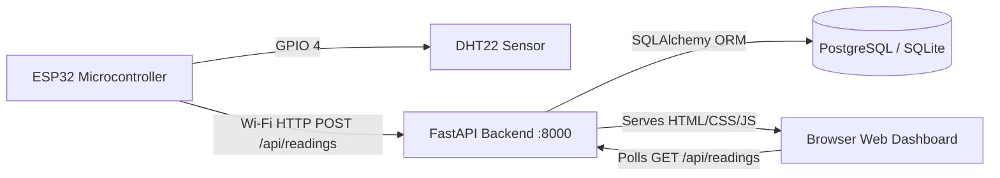

# Smart Classroom Environmental Monitoring System
> **Real-Time IoT Monitoring with ESP32, DHT22, FastAPI, PostgreSQL & Modern Light Theme Dashboard**
> *Developed for Master of Computer Applications (MCA) Project Demonstration*

---

## 🌟 Overview & Key Enhancements

The **Smart Classroom Environmental Monitoring System** is an end-to-end IoT and full-stack web application designed to monitor ambient classroom temperature and relative humidity in real time. 

### What's New in this Release:
1. **Premium Light Theme**:
   - Clean, light dashboard inspired by high-end smart-building automation platforms.
   - White and soft off-white cards (`#ffffff`, `#f8fafc`) with delicate borders, subtle drop-shadows, and zero dark panels.
   - Modern typography hierarchy utilizing Google Fonts (`Inter` and `Plus Jakarta Sans`).
   - Fully responsive across desktop workstations, laptops, tablets, and smartphones.

2. **Dynamic Temperature Color System**:
   - Card background tints, borders, thermometer icon accents, status badges, and Chart.js accents adapt dynamically:
     - ❄️ **Cool (< 18°C)**: Soft Blue theme (`#0284c7`) with `Cool` status badge.
     - 🌿 **Comfortable (18°C – 24°C)**: Fresh Green theme (`#16a34a`) with `Comfortable` status badge.
     - ☀️ **Warm (> 24°C – 30°C)**: Warm Amber/Orange theme (`#ea580c`) with `Warm` status badge.
     - 🔥 **Hot (> 30°C)**: Alert Red theme (`#dc2626`) with `Hot` status badge.
   - Smooth CSS color transitions when crossing thresholds.

3. **Independent Relative Humidity Color System**:
   - Humidity metrics and charts update independently of temperature:
     - ⚠️ **Low (< 30%)**: Amber caution indicator.
     - 💧 **Normal (30% – 60%)**: Emerald green optimal indoor air quality range.
     - 🌊 **Elevated (> 60% – 70%)**: Blue indicator.
     - 🚨 **High (> 70%)**: Rose red high humidity alert.

4. **Real Hardware Activity Detection**:
   - Hardware status (`Online` / `Offline`) is calculated from the timestamp of the latest real reading.
   - If no sensor reading has arrived in **15 seconds**, the system automatically flags the ESP32 as offline and displays a warning banner.
   - Friendly empty state when waiting for the first sensor transmission.

5. **Live Chart.js Visualizations**:
   - Two separate responsive line charts for Temperature and Relative Humidity.
   - Smooth cubic bezier curves, time-based horizontal axis, formatted tooltips.
   - Automatic non-blocking polling every **3.5 seconds** (no page reload, no duplicate points).

6. **Full-Featured Telemetry Table & Export**:
   - Displays up to 15 latest readings with dynamic badges and timestamps.
   - One-click **Export CSV** button for data analysis and reporting.

---

## 🏛️ System Architecture



- **Microcontroller**: ESP32 NodeMCU DevKit V1
- **Sensor**: DHT22 (AM2302 High-Precision Digital Sensor)
- **Protocol**: HTTP/1.1 REST JSON Telemetry
- **Backend**: FastAPI 0.110+ (Python 3.12 Asynchronous ASGI)
- **Database**: PostgreSQL 16 (with automatic zero-config SQLite fallback for local development)
- **Containerization**: Docker & Docker Compose

---

## 🚀 How to Run the Project on Windows 11

### Option 1: Direct Local Execution (Fastest & Easiest)

1. Open **Windows PowerShell** in the project directory:
   ```powershell
   cd c:\projects\iot
   ```

2. Run the automated startup script:
   ```powershell
   .\run_local.ps1
   ```
   *Or execute manually with the virtual environment:*
   ```powershell
   .\.venv\Scripts\uvicorn.exe app.main:app --host 0.0.0.0 --port 8000 --reload
   ```

3. Open your browser:
   - **Live Web Dashboard:** [http://localhost:8000](http://localhost:8000)
   - **Interactive API Swagger Docs:** [http://localhost:8000/docs](http://localhost:8000/docs)
   - **System Health Check:** [http://localhost:8000/health](http://localhost:8000/health)

---

### Option 2: Run with Docker Compose

If Docker Desktop is installed and running on Windows:
```powershell
docker-compose up --build
```
This orchestrates the PostgreSQL 16 database container and the FastAPI web container together.

---

## 🧪 Testing & Demonstration Commands

### 1. Test a Single HTTP POST Reading via PowerShell
```powershell
.\test_post.ps1 -Temperature 28.5 -Humidity 65.0
```

### 2. Demonstrate All 4 Temperature Threshold States (Faculty Walkthrough)
Run the bundled simulator to showcase all color transitions:
```powershell
.\.venv\Scripts\python.exe simulate_esp32.py --demo
```
This walks through:
1. `16.4°C` — **Cool Blue**
2. `22.0°C` — **Comfortable Green**
3. `27.2°C` — **Warm Orange**
4. `32.8°C` — **Hot Red**

### 3. Continuous ESP32 Stream Simulation
```powershell
.\.venv\Scripts\python.exe simulate_esp32.py --stream
```

### 4. Seed 20 Historical Readings
```powershell
.\.venv\Scripts\python.exe simulate_esp32.py --seed 20
```

---

## 📡 ESP32 Hardware Integration

The Arduino sketch is located at `esp32/esp32_dht22.ino`.

### Wiring Diagram
| DHT22 Pin | ESP32 Pin | Description |
|-----------|-----------|-------------|
| Pin 1 (VCC) | 3.3V / 5V | Power Supply |
| Pin 2 (DATA) | GPIO 4 | Digital Telemetry (10k pull-up) |
| Pin 3 (NC) | Not connected | None |
| Pin 4 (GND) | GND | Common Ground |

### Flashing Steps:
1. Open Arduino IDE and install the `ESP32` board definitions.
2. Install libraries: `DHT sensor library` and `ArduinoJson`.
3. In `esp32_dht22.ino`, set your Wi-Fi SSID, password, and your computer's LAN IP address:
   ```cpp
   const char* WIFI_SSID     = "College_WiFi";
   const char* WIFI_PASSWORD = "Password123";
   const char* SERVER_URL    = "http://192.168.1.50:8000/api/readings";
   ```
4. Select `ESP32 Dev Module`, choose COM port, and click **Upload**.

---

## 📚 REST API Reference

| Method | Endpoint | Description |
|--------|----------|-------------|
| `GET` | `/` | Serves the Light-Themed Web Dashboard |
| `GET` | `/health` | System health, database connection, reading count |
| `GET` | `/api/readings/latest` | Latest single sensor reading with dynamic status |
| `GET` | `/api/readings?limit=30` | List of recent readings ordered descending |
| `POST` | `/api/readings` | Ingests new telemetry `{"temperature": 25.5, "humidity": 60.0}` |
| `GET` | `/api/device/status` | Real-time ESP32 online/offline status (15s rule) |
| `GET` | `/api/thresholds` | Current temperature and humidity threshold settings |
